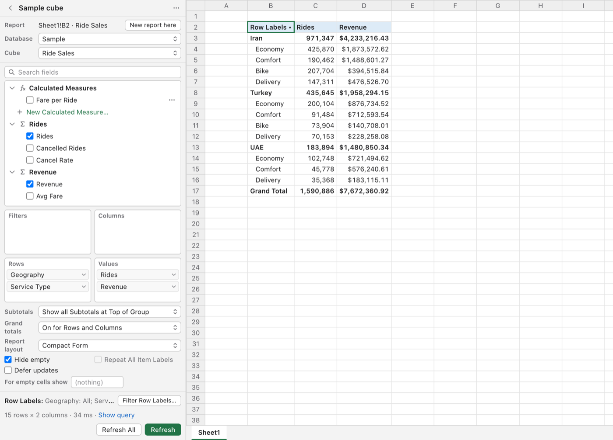

# Cube Explorer: SSAS cubes in Excel for Mac

Excel for Windows can connect to a **SQL Server Analysis Services (SSAS)** cube and
build PivotTables from it. Excel for Mac cannot: the option is simply not there.
**Cube Explorer** adds it. You get a PivotTable-style panel inside Excel for Mac that
connects to your company's cube, lets you pick measures and fields, filter, drill
down and calculate, and writes refreshable results into your sheet. It works the way
Excel on Windows does, with the same menus and words.



*The panel and a report from the built-in Sample cube (shown here in the panel's
browser preview).*

Nothing is installed or changed on the company server. Your Mac signs in to the cube
the same way Windows Excel does, with your Windows (domain) user name and password.

---

## Contents

- [What it can do](#what-it-can-do)
- [What you need](#what-you-need)
- [Install](#install)
- [Turn it on in Excel](#turn-it-on-in-excel)
- [Connect to your cube](#connect-to-your-cube)
- [Use it, step by step](#use-it-step-by-step)
- [Update](#update)
- [Uninstall](#uninstall)
- [If something goes wrong](#if-something-goes-wrong)
- [How it compares with Excel on Windows](#how-it-compares-with-excel-on-windows)
- [Privacy and security](#privacy-and-security)
- [How it works (for developers)](#how-it-works-for-developers)
- [License](#license)

---

## What it can do

**Building a report (PivotTable)**
- Field list with measures (by measure group and display folder), dimensions and
  their fields, **KPIs** (Value, Goal, Status, Trend) and **named sets**; search.
- The four areas: Filters, Columns, Rows, Values. Tick a field, drag it, or use its
  menu to move it.
- **Report Layout**: Compact Form (Excel's default), Outline Form, Tabular Form.
- **Subtotals**: none, at the bottom of each group, or at the top of each group.
  **Grand Totals**: Excel's four choices. **Repeat All Item Labels**, **For empty
  cells show**, **Hide empty** rows and columns, **Defer updates**.
- Drill down and up (Expand / Collapse, Expand / Collapse Entire Field).
- Several reports per workbook and per sheet; each sheet's report follows you as you
  move between sheets, as on Windows.

**Sorting and filtering, from the sheet too**
- Click a cell with a small ▾ in the report (a page filter, "Row Labels", "Column
  Labels", a field name) to open the same choices as the Windows dropdown.
- Sort A to Z, Z to A, or by any measure. In nested fields, sorting by a value
  works within each outer item, as in Excel.
- **Label Filters**, **Value Filters** (including **Top 10**: items, percent or sum),
  and **Date Filters** for date fields (Today, This Month, Last Quarter, Year to
  Date, Between, All Dates in the Period, and the rest of Excel's list).
- Item checklists with search. Totals count only the items that are shown
  ("visual totals"), the default for cube PivotTables on Windows.

**Values**
- **Show Values As**: all 14 of Excel's choices (% of Grand / Column / Row Total, % Of,
  % of Parent Row / Column / Parent Total, Difference From, % Difference From,
  Running Total In, % Running Total In, Rank Smallest to Largest / Largest to
  Smallest, Index), with base field and base item.
- **Number Format** per value field, kept on every refresh.
- The same measure more than once (**Duplicate**), for example the number and its
  percentage side by side.
- KPI Status and Trend shown as Excel's traffic lights and arrows.

**Calculations**
- **Calculated measures** (Windows: OLAP Tools > MDX Calculated Measure), with a
  **Check** button that asks the cube whether the formula works.
- **Calculated items** of a field (Windows: OLAP Tools > MDX Calculated Member).
- **Group Items**: show several items of a field as one item. *(Excel on Windows
  cannot group a cube field; Cube Explorer can.)*

**More**
- **Show Details**: the rows behind a number, on a new sheet (first 1,000 rows), like
  double-clicking a value on Windows.
- **Cube formulas**: `CUBE.VALUE`, `CUBE.MEMBER`, `CUBE.MEMBERPROPERTY`,
  `CUBE.RANKEDMEMBER` and `CUBE.SETCOUNT` in any cell, and **Convert to Formulas**,
  which turns a report into such formulas (Windows: OLAP Tools > Convert to Formulas).
- **Refresh**, **Refresh All**, **Refresh when the workbook opens**, and Cancel for a
  slow query.
- A built-in **Sample cube** to try everything without a server.

---

## What you need

- A Mac with **macOS 13.5 (Ventura) or later**, Apple silicon or Intel.
- **Microsoft Excel for Mac**, version 16, kept up to date (Microsoft 365 or a
  perpetual licence; add-ins are allowed by default).
- Your company's **SSAS server name**, as you would type it in Windows Excel
  (`server`, `server:port` or `server\instance`), and your **Windows user name and
  password** (`DOMAIN\user`).
- Access to that server: the office network or the company **VPN**, the same as on
  Windows.
- An internet connection **once**, while installing.

**You do not need to install anything else first.** The installer brings what it
needs and keeps it in its own folder:

| Part | What it is for | Where it comes from |
|---|---|---|
| Python 3.12 | runs the helper | downloaded by uv into the Cube Explorer folder |
| pyspnego, keyring, cryptography (and their small dependencies) | Windows sign-in (NTLM), storing your password in the Keychain, the local certificate | installed by uv from PyPI into the helper's private environment |
| [uv](https://github.com/astral-sh/uv) 0.12.5 | installs Python and those libraries | your Mac's own copy if you have one, otherwise downloaded and checked against its published SHA-256 |
| [Node.js](https://nodejs.org) 24 LTS | builds the Excel panel (React, TypeScript, Vite) | your Mac's own copy if it is recent enough, otherwise downloaded and checked against its published SHA-256 |

Nothing is installed system-wide, and nothing needs administrator rights.

---

## Install

Open **Terminal** (press Cmd+Space, type *Terminal*, press Return) and paste this one
line:

```bash
curl -fsSL https://raw.githubusercontent.com/danaenayati/excel-ssas-mac/main/get.sh | bash
```

That downloads Cube Explorer into a folder called **CubeExplorer** in your home
folder and installs it. It takes a few minutes the first time.

**While this repository is private**, the line above cannot download it without your
GitHub login. Use one of these instead:

- With the [GitHub command-line tool](https://cli.github.com) signed in:
  ```bash
  gh repo clone danaenayati/excel-ssas-mac ~/CubeExplorer && ~/CubeExplorer/install.sh
  ```
- With git:
  ```bash
  git clone https://github.com/danaenayati/excel-ssas-mac.git ~/CubeExplorer && ~/CubeExplorer/install.sh
  ```
- Without either: on the GitHub page click **Code > Download ZIP**, open the ZIP,
  then in Terminal type `bash ` (with a space), drag `install.sh` from the unzipped
  folder into the Terminal window, and press Return.

**During the install, macOS asks for your Mac password (or Touch ID) once.** That
lets Excel trust the helper on this Mac. The certificate involved works only for
`https://localhost`, and the key that made it is destroyed straight away.

When it finishes, it prints **Done. Cube Explorer is installed.**

---

## Turn it on in Excel

You do this once.

1. **Quit Excel completely** (Cmd+Q) if it is open, then open it again.
2. On the **Home** tab, click **Add-ins** (at the far right of the ribbon).
3. Choose **Cube Explorer** from the list.
4. A **Cube Explorer** button now sits at the far right of the **Home** tab. Click it
   whenever you want the panel.

Older Excel versions have no Add-ins button on Home: use **Insert > My Add-ins**
(the small arrow beside it) > **Cube Explorer** instead.

Workbooks with a Cube Explorer report open the panel by themselves the next time.

---

## Connect to your cube

**Try the Sample cube first.** In the panel, choose **Sample cube**. It is built in and
needs no server or VPN, so you can see how everything works.

**Then add your company's server.** Connect the VPN, then either:

- In the panel: **Add connection**, then fill in the server, your `DOMAIN\user` and
  your password. Or
- In Terminal, run the checker, which tests each step and says exactly where it stops
  if something is wrong, then offers to save the connection:
  ```bash
  ~/CubeExplorer/cube-probe
  ```

Your password is stored in the Mac's **Keychain**, never in a workbook or a file.

---

## Use it, step by step

1. **Pick the cube.** Choose your connection, then the database and the cube.
2. **Click the cell** where the report should start (an empty area of a sheet).
3. **Tick fields.** Measures go to **Values**, other fields to **Rows**. Use a field's
   menu (or drag it) to move it to **Columns** or **Filters**. The report appears at
   the selected cell, and the cube works out every number, including totals.
4. **Filter and sort.** Click any ▾ in the report, or choose **Sort and Filter…** in a
   field's menu: sort, Label / Date / Value Filters, Top 10, the item checklist.
   A filtered field shows ▼.
5. **Lay it out.** Under the areas: **Report layout**, **Subtotals**, **Grand totals**,
   **Repeat All Item Labels**, **For empty cells show**.
6. **Show values another way.** In a Values field's menu: **Show Values As**, **Number
   Format**, **Duplicate**.
7. **Calculate.**
   - A new measure: **Calculated Measures > New Calculated Measure…** at the top of
     the field list. Type a name and an MDX formula, for example
     `[Measures].[Revenue] / [Measures].[Rides]`, press **Check**, then **OK**, and
     tick it like any measure.
   - A new item of a field: that field's **Sort and Filter… > Calculated Item…**.
   - Several items as one: **Sort and Filter… > Group Items…**, tick the items, name
     the group.
8. **Drill down.** Select a row or column label, then **Expand** or **Collapse** in
   the panel, or use **Expand / Collapse Entire Field**.
9. **See the details.** Select a number and press **Show Details**: its rows go to a
   new sheet.
10. **Refresh.** **Refresh** updates the report, **Refresh All** every report in the
    workbook. The report's **⋯** menu has **Refresh when the workbook opens**.
11. **Use formulas.** Type cube formulas in any cell, for example:
    ```
    =CUBE.VALUE("Sales Cube/Sales/Model", "[Measures].[Revenue]", "[Date].[Year].&[2025]")
    =CUBE.MEMBER("Sales Cube", "[Date].[Year].&[2025]")
    ```
    The first argument is the connection's name, followed by `/Database/Cube` when the
    server has more than one. The other arguments are unique member names, as the
    cube writes them. Or choose **Convert to Formulas** in the report's **⋯** menu to
    turn a whole report into formulas you can rearrange freely.
12. **More reports.** **New report here** starts another report at the selected cell.
    Each sheet's report comes back when you go to that sheet.

The report is saved in the workbook. Open the file later and press **Refresh** for new
numbers. A colleague without Cube Explorer still sees the numbers as plain cells.

---

## Update

Run the install line again (or `~/CubeExplorer/install.sh` if you cloned it). It
updates in place and keeps your connections. Then close the panel (✕) and open it
again from the **Home** tab; after an update that changes the formulas, quit and reopen
Excel.

---

## Uninstall

```bash
~/CubeExplorer/uninstall.sh
```

It removes the helper and its login item, the add-in, the downloaded tools, saved
connections and their Keychain passwords, and the certificate trust (macOS may ask for
your password). Your workbooks keep the numbers already in them. Afterwards you can
delete the `~/CubeExplorer` folder, and quit and reopen Excel to clear the button.

---

## If something goes wrong

| What you see | What to do |
|---|---|
| "The helper is not running." | In Terminal: `launchctl kickstart -k gui/$(id -u)/com.cubebridge.helper` |
| The panel is blank, or Excel cannot load the add-in | Run the installer again, then quit and reopen Excel. |
| Cube Explorer is not in the **Add-ins** list | Quit Excel completely (Cmd+Q), reopen it, then **Home > Add-ins** again. |
| "Can't reach the server" | Connect the VPN. Run `~/CubeExplorer/cube-probe` to see which step fails. |
| "The server refused the sign-in" | Check the user name is `DOMAIN\user` and the password is current. |
| Sign-in fails although the password is right | Your server may accept only Kerberos. That is not supported yet; see below. |
| "Couldn't find the port of instance …" | Ask a Windows colleague for the port and enter the server as `name:port`. |
| "This view would return … cells" | Add a filter or remove a field. The limit protects Excel from freezing. |
| Nothing appears after ticking fields | Select an empty cell outside other reports; on a new sheet the report starts at the selected cell. |
| macOS asks whether Python may use the keychain or the local network | Choose **Always Allow** / **Allow**. It is the helper. |
| A cube formula shows `#N/A` | Point at the cell: the message says why (unknown member, wrong connection name, no VPN). |

The helper's log is `~/Library/Application Support/CubeBridge/logs/helper.log`. It
records what failed and why, never passwords. The localhost certificate lasts about two
years; the panel warns before it expires, and running the installer renews it.

---

## How it compares with Excel on Windows

**Works as on Windows:** everything listed under [What it can do](#what-it-can-do).

**Goes further than Windows for cube reports:** grouping items of a cube field (Excel
on Windows greys out Group for cube PivotTables).

**Different:**
- It is not a native PivotTable object. Excel's PivotTable tabs, PivotTable Styles,
  Slicers, Timelines and PivotCharts do not attach to it. Ordinary charts and formulas
  that point at the report's cells work, and keep working after a refresh.
- Changes made through the panel cannot be undone with Cmd+Z; change them back in the
  panel instead.
- Show Details is a button in the panel instead of a double-click.
- Cube formulas take unique member names. On Windows a `CUBEVALUE` can point at a
  cell holding a `CUBEMEMBER`; here a cell can only hold text or a number, so the names
  go into the formula itself (Convert to Formulas does this for you). They read
  `CUBE.VALUE` rather than `CUBEVALUE`, because add-in functions always carry a name
  prefix.
- Named sets are supported when their items come from one field.
- Sign-in is NTLM with your user name and password. Kerberos-only servers and
  connections over HTTP (`msmdpump.dll`) are not supported yet.
- PivotTables your colleagues built on Windows do not refresh on a Mac; build the
  report again here once.

---

## Privacy and security

- The helper runs only on your Mac and only answers Excel on the same Mac
  (`https://localhost`), with a secret token that only the panel knows.
- Your password stays in the macOS Keychain. It is never written to a workbook, a file
  or the log.
- Cube Explorer only reads from the cube. It cannot change data on the server.
- Formulas typed into the panel or found in a workbook are checked before they reach the
  cube: one expression only, no statements.
- The installer downloads only from the official sources above and checks each
  download against a fixed checksum before using it.

---

## How it works (for developers)

```
addin/    The Excel panel: an Office.js task-pane add-in (React, TypeScript, Vite),
          plus the custom functions behind CUBE.*
helper/   A local Python service: SSAS's native TCP protocol with NTLM sign-in,
          MDX generation, and a small HTTPS API for the panel
docs/     Design notes and images
```

- The panel builds a layout; the helper turns it into MDX, sends it to SSAS over its
  native binary protocol ([MS-SSAS], the same one ADOMD.NET uses on Windows), and turns
  the answer into a grid the panel writes into the sheet. The JSON contract between the
  two is `addin/src/types.ts`.
- Tests: `cd helper && uv run pytest` and `cd addin && npm test`.
- Try the panel in a browser without Excel, against the built-in Sample cube:
  `cd addin && npm run dev`, then open `http://localhost:5173/`.
- The undocumented parts of the SSAS wire protocol come from the
  [ssas-xmla-tcp](https://github.com/oluies/ssas-xmla-tcp) project (Apache-2.0); see
  `THIRD_PARTY_NOTICES.md`.
- Known gaps: Kerberos, HTTP connections, named-instance lookup on port 2382 is
  untested against a real server.

---

## License

Copyright (C) 2026 Dana Enayati

Cube Explorer is free software: you can redistribute it and/or modify it under the
terms of the **GNU General Public License** as published by the Free Software
Foundation, either **version 3** of the License, or (at your option) any later version.
It is distributed in the hope that it will be useful, but **without any warranty**;
see [LICENSE](LICENSE) for the full text.

Libraries and tools by others are listed with their licences in
[THIRD_PARTY_NOTICES.md](THIRD_PARTY_NOTICES.md).
